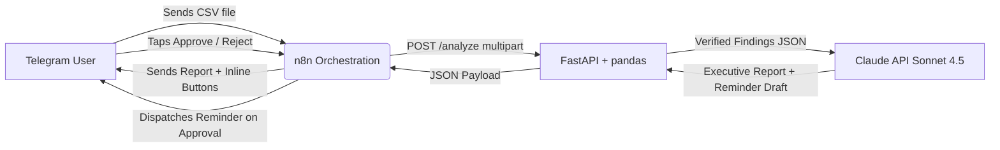

# Financial-Analysis-and-Payment-Reminder-Agent
# AI Business Loss Detector

An intelligent financial watchdog agent designed for small business owners. Business owners can upload financial spreadsheets (expenses or invoices) directly via Telegram. The system deterministically inspects the data for revenue leakage and accounting anomalies, produces evidence-backed reports powered by Claude, and drafts polite collection reminders that require explicit owner approval before being dispatched.

---

## Table of Contents

- [Overview & What It Does](#overview--what-it-does)
- [Architecture](#architecture)
- [Design Principles](#design-principles)
- [Technology Stack](#technology-stack)
- [How to Run on Windows](#how-to-run-on-windows)
  - [Prerequisites](#prerequisites)
  - [Step 1: Environment Setup](#step-1-environment-setup)
  - [Step 2: Start the FastAPI Backend (Uvicorn)](#step-2-start-the-fastapi-backend-uvicorn)
  - [Step 3: Start Cloudflare Tunnel](#step-3-start-cloudflare-tunnel)
  - [Step 4: Launch n8n with Docker Compose](#step-4-launch-n8n-with-docker-compose)
  - [Step 5: Import and Publish Workflow in n8n](#step-5-import-and-publish-workflow-in-n8n)
  - [Step 6: Running Automated Tests & Testing Demo Files](#step-6-running-automated-tests--testing-demo-files)
- [API Contract](#api-contract)
- [Future Work](#future-work)

---

## Overview & What It Does

Small business owners frequently experience financial leakage due to duplicate vendor payments and uncollected overdue invoices. This application acts as an automated, interactive auditor:

1. **Zero-Friction Ingestion via Telegram**: Upload an expenses or invoices CSV file directly in chat.
2. **Automatic Schema Detection & Normalization**: The backend inspects column headers to identify whether the file contains expense records (`date, vendor, amount, reference`) or customer invoices (`invoice_id, customer, amount, due_date, status`).
3. **Deterministic Fact Extraction**:
   - **Possible Duplicate Expenses**: Identifies records sharing identical vendor, amount, date, and reference fields. Points directly to human-readable spreadsheet row numbers (`index + 2`).
   - **Overdue Invoices**: Flags all unpaid invoices where `due_date` is earlier than today (`date.today()`).
4. **AI-Powered Explanations & Reminder Drafting**: Findings are handed to Anthropic's Claude (`claude-sonnet-4-5`), which synthesizes an executive summary citing specific rows and balances, while drafting a courteous payment reminder for overdue clients.
5. **Failsafe Deterministic Fallback**: If the Claude API key is absent or the API request fails, a structured template report is returned automatically so operations are never interrupted.
6. **Human-in-the-Loop Approval**: Telegram presents interactive **Approve** and **Reject** buttons. Reminders are only dispatched if the owner gives explicit approval.

---

## Architecture

The system connects user-facing chat, webhook orchestration, deterministic Python analytics, and large language model intelligence in a closed loop:



### Flow Breakdown

1. **Telegram -> n8n**: The business owner uploads a CSV document to the Telegram bot. The `Telegram Trigger` node in n8n receives the message payload and downloads the file binary.
2. **n8n -> FastAPI/pandas**: n8n sends an HTTP `POST` multipart request to `http://host.docker.internal:8000/analyze`.
3. **FastAPI/pandas -> Claude**: Pandas parses the data, normalizes columns, and runs deterministic checks. The verified findings array is passed to Claude (`claude-sonnet-4-5`) to generate an owner-ready explanation and polite reminder draft.
4. **Claude -> Telegram**: n8n formats the returned report and sends it to the owner with interactive **Approve** and **Reject** buttons.
5. **Owner Approval**: If approved, n8n proceeds to send the drafted reminder. If rejected, the draft is discarded.

---

## Design Principles

The codebase adheres strictly to core operational rules:

1. **Python finds facts**: All calculations, filtering, date comparisons, and groupings are handled strictly by Python and pandas. The AI is never trusted to perform accounting math or spot raw discrepancies.
2. **AI explains, never invents**: The AI receives only verified structured JSON findings. It is forbidden from hallucinating names, invoices, amounts, references, or dates.
3. **Human approves**: Nothing is ever communicated externally or finalized without explicit human authorization. The bot proposes; the business owner decides.
4. **Duplicates are "possible", not confirmed**: Groupings with identical vendor, amount, date, and reference are labeled as `possible_duplicate` with status `needs_review`. They are potential administrative errors or recurring items, never declared as confirmed fraud or definitive loss.
5. **Always cite evidence**: Every finding references concrete spreadsheet row numbers or invoice IDs so the owner can instantly verify claims in their source file.

---

## Technology Stack

| Layer | Component | Purpose |
|---|---|---|
| **Frontend** | Telegram Bot | File upload interface and interactive Approve/Reject controls |
| **Orchestration** | n8n (Docker) | Manages webhooks, document routing, API calls, and conversational state |
| **Backend & Analytics** | FastAPI, pandas, uvicorn | File validation, column normalization, and deterministic data analysis |
| **Intelligence** | Anthropic Claude API (`claude-sonnet-4-5`) | Natural-language explanation and polite reminder generation |
| **Tunneling & Ingress** | Cloudflare Quick Tunnel (`cloudflared`) | Secure public HTTPS endpoint for incoming Telegram webhooks |
| **Testing** | pytest, httpx | Automated verification of API endpoints and edge cases |

---

## How to Run on Windows

1. Start Docker Desktop.
2. Run `.\cloudflared.exe tunnel --url http://localhost:5678` and copy the https URL.
3. Put it in `.env` as `WEBHOOK_URL=<url>/` (with trailing slash).
4. Run `docker compose up -d --force-recreate`.
5. Run `uvicorn main:app --host 0.0.0.0 --port 8000`.
6. Open `http://localhost:5678` and click Publish.

---

### Running Automated Tests & Testing Demo Files

#### Run Automated Unit & API Tests

In an activated terminal:

```powershell
pytest test_api.py -v
```

Expected output:
```
test_api.py::test_health PASSED
test_api.py::test_expenses_csv_finds_one_possible_duplicate PASSED
test_api.py::test_invoices_csv_finds_one_overdue_for_inv_102 PASSED
test_api.py::test_txt_upload_returns_400 PASSED
test_api.py::test_wrong_columns_returns_400 PASSED
```

#### Run the Telegram End-to-End Demo

1. Open Telegram and start a chat with your bot (`/start`).
2. **Send `expenses.csv` or `demo_expenses.csv`**: The bot replies with an Overview, duplicate entries, unusual expenses (Q3 + 1.5*IQR), and top vendors by spend in ₹ format, accompanied by monthly and vendor breakdown charts.
3. **Send `invoices.csv` or `demo_invoices.csv`**: The bot detects overdue invoices, provides invoice details, aging buckets (0-30, 31-60, 60+ days), top unpaid customers, payment reminder drafts with **Approve** / **Reject** controls, and charts.
4. **Tap Approve**: The bot confirms and sends the payment reminder.
5. **Upload invalid file (e.g., `.txt` or CSV with wrong columns)**: The bot returns a polite error message specifying expected column formats.

---

### Telegram Analysis & Visual Charts

When documents are analyzed with `chat_id` (Telegram bot flow):
- **Expenses (CSV / XLSX)**: Calculates total spend, transaction count, average, date range, spend by vendor (top 5), spend by month, unusual expense outliers (`amount > Q3 + 1.5*IQR`), and exact duplicate rows.
- **Invoices (CSV / XLSX)**: Calculates total billed, paid, unpaid, overdue count and amount, aging buckets (`0-30`, `31-60`, `60+` days overdue relative to `date.today()`), and top unpaid customers.
- **Indian Rupee Formatting**: All figures use Indian numbering format (e.g., `₹1,23,456`).
- **Visual Charts via Telegram**: Sends generated Matplotlib charts (`#4F46E5`) directly to the Telegram chat:
  - Expenses: Monthly spend breakdown & top 5 vendors.
  - Invoices: Aging buckets & unpaid balance by customer.
- **Phone-friendly HTML Report**: Structured into *Overview*, *Findings*, *Top vendors* (or *Aging*), and *Next steps*, escaping HTML entities and keeping under 4,000 characters.

---

## Dashboard

Run the interactive Streamlit visual analytics dashboard:

1. Ensure the FastAPI backend is running first:
   ```powershell
   uvicorn main:app --host 0.0.0.0 --port 8000
   ```
2. In a second terminal, launch Streamlit:
   ```powershell
   streamlit run dashboard.py
   ```
3. Open `http://localhost:8501` in your browser.

### What It Shows
- **Upload & Sample Loading**: Upload an expenses or invoices CSV, or load the included `expenses.csv` / `invoices.csv` via sidebar buttons.
- **KPI Summary Cards**: Real-time totals for findings, possible duplicates, overdue invoices, and total flagged dollar amount.
- **Findings Table & CSV Download**: Detailed breakdown table (labeling duplicates as *"Possible duplicate (needs review)"*) with a one-click CSV download button.
- **Flagged Amount Chart**: Interactive Plotly bar chart displaying flagged amounts across findings.
- **Evidence JSON Expanders**: Per-finding collapsible inspection of exact backend evidence records.
- **AI Report & Reminder Draft**: AI explanation text and draft collection reminder with disclaimer (*"Reminder is a draft. Nothing is sent from this dashboard."*).

---

## API Contract

### Health Check

- **Method**: `GET`
- **Endpoint**: `/health`
- **Response**:
  ```json
  { "ok": true }
  ```

---

### Analyze Document

- **Method**: `POST`
- **Endpoint**: `/analyze`
- **Body**: `multipart/form-data` with form field `file` containing the CSV file.
- **Success Response (`200 OK`)**:
  ```json
  {
    "status": "completed",
    "findings": [
      {
        "type": "possible_duplicate",
        "amount": 4500.0,
        "evidence": {
          "source_file": "expenses.csv",
          "rows": [5, 17],
          "matching_fields": ["vendor", "amount", "date", "reference"]
        },
        "status": "needs_review"
      }
    ],
    "report": "Summary: the file was checked and the following verified findings need your review...",
    "reminder": ""
  }
  ```
- **Client Error (`400 Bad Request`)**:
  ```json
  {
    "detail": "This CSV does not have the expected columns. Use date, vendor, amount, reference for expenses, or invoice_id, customer, amount, due_date, status for invoices."
  }
  ```

---

## Future Work

Planned enhancements for future iterations of the platform:

1. **PostgreSQL Audit Trail**:
   - Store all uploaded documents, detected anomalies, owner decisions (approved vs. rejected), and outgoing reminder dispatch timestamps in a persistent relational database for regulatory and accounting audit compliance.

2. **PDF & OCR Ingestion**:
   - Integrate OCR pipelines (Tesseract, AWS Textract, or document vision models) to ingest scanned paper receipts, PDF supplier invoices, and bank statements directly from Telegram photo/document uploads.

3. **Statistical & ML Anomaly Detection (IQR / Isolation Forest)**:
   - Go beyond exact duplicate detection by implementing Interquartile Range (IQR) thresholding and Isolation Forests to flag outlier transaction amounts, uncharacteristic vendor charges, duplicate billings with slight date offsets, and sudden expense spikes.

4. **Sales & Gateway Reconciliation**:
   - Perform automated two-way and three-way reconciliation matching bank ledger feeds with payment gateway transactions (Stripe, Razorpay, PayPal) and Point-of-Sale (POS) / e-commerce sales reports.

5. **Interactive Streamlit Dashboard**:
   - Provide business owners and financial managers with a web dashboard featuring visual cash-flow charts, accounts receivable aging buckets, loss mitigation metrics, and manual review queues.

6. **Multi-User Access Control (RBAC)**:
   - Add organization multi-tenancy and role-based permissions (e.g., Accountant, Financial Controller, Business Owner) allowing staff to submit files for review while restricting final payment reminder approvals to authorized managers.
